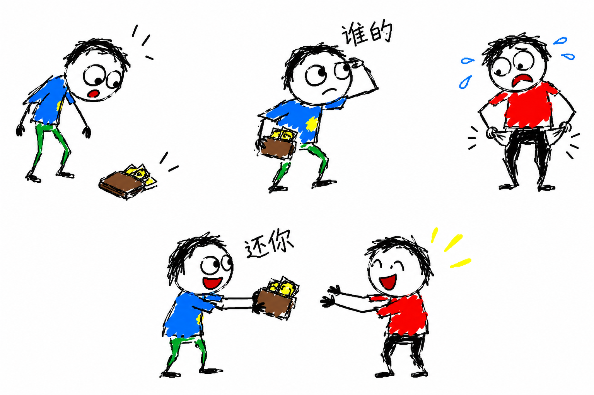
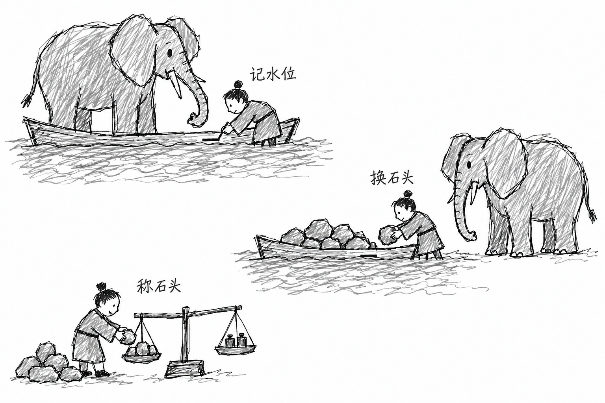
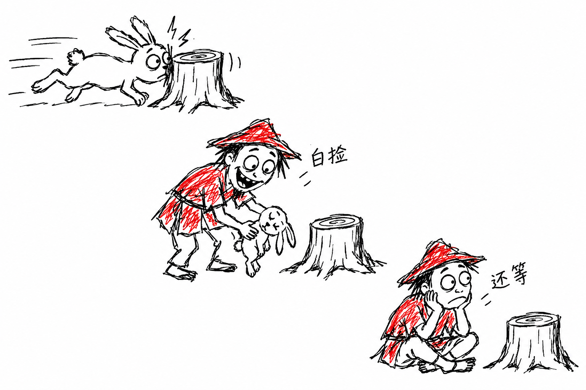
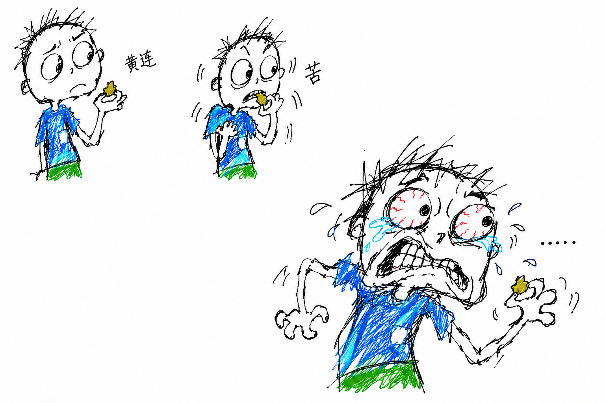
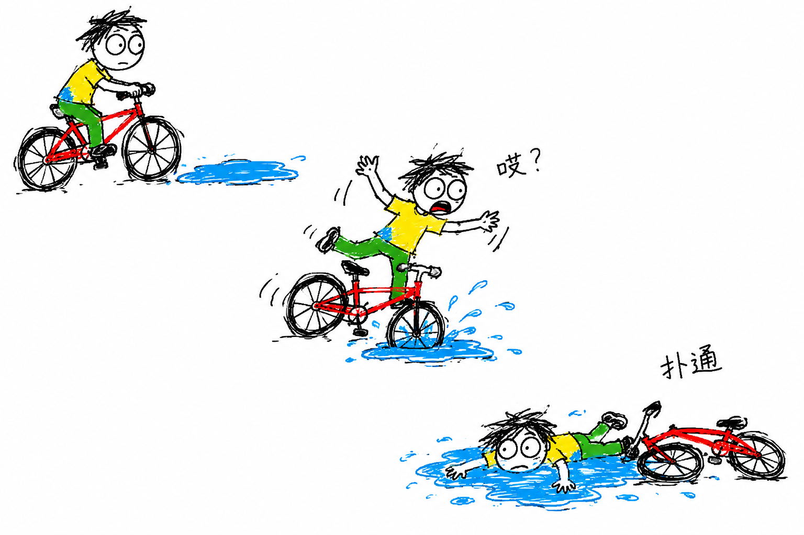
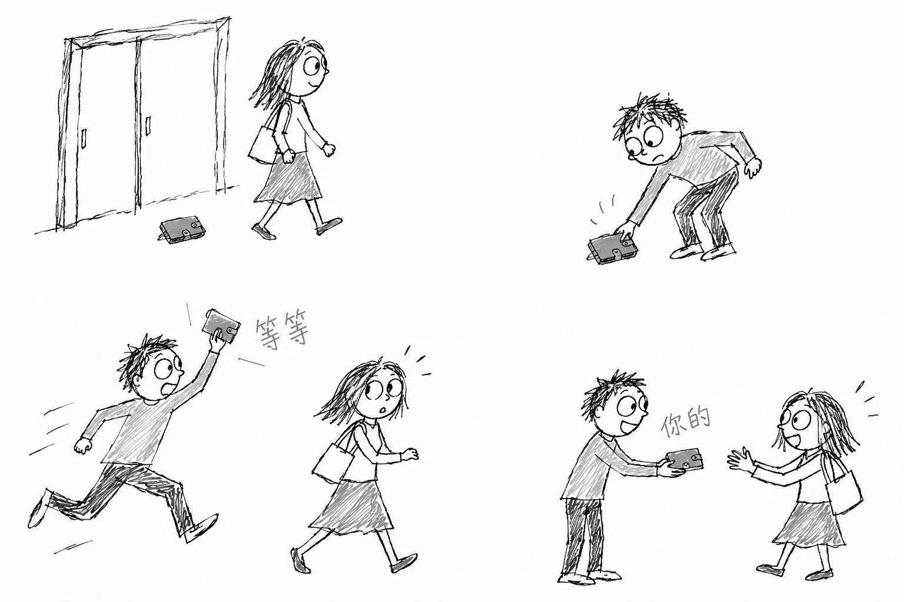
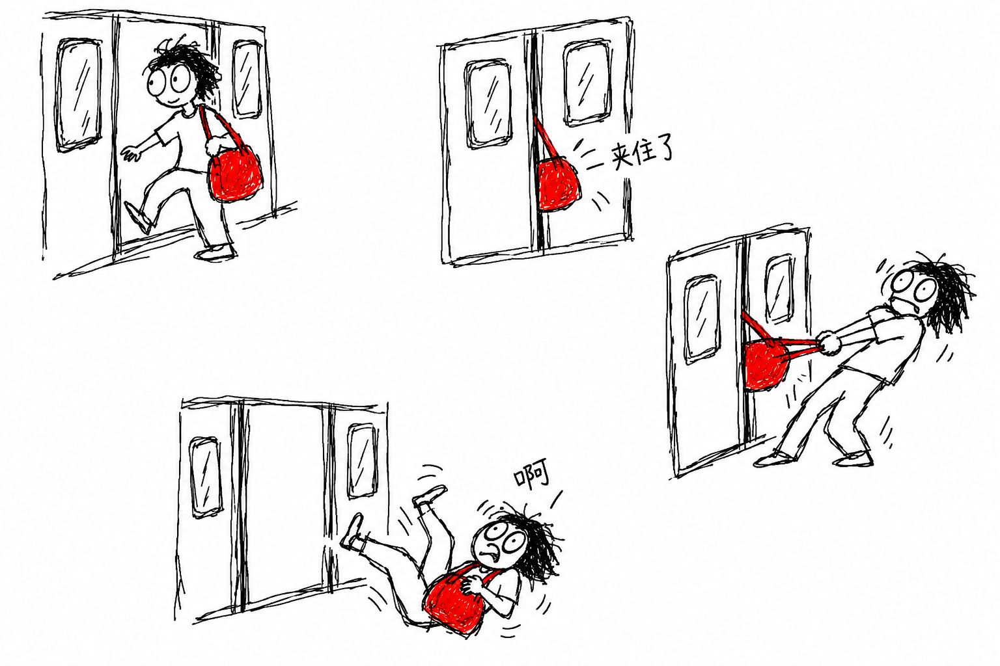

# Oops Paint 使用说明

`Oops Paint` 是一个生成潦草 MS Paint 风格事件解释图、成语解释图和吐槽重现图的 Skill。

它追求的不是精致插画，而是这种效果：白纸上散着几坨小场景，线条像鼠标手抖画出来的，颜色或灰色填充都不均匀，人物动作夸张。文字很少，但不是完全没有，看起来像“想说明白，但又画得很烂”。

它适合成语解释图、事件示意图、吐槽式重现图和荒诞小故事解释图，也适合单纯想“用潦草画风把一件事讲明白”的时候。主题可以是 `拾金不昧`、`曹冲称象`、`哑巴吃黄连`，也可以直接说 `画一个人骑车掉进水坑的解释图` 或 `给我一个潦草的 MS Paint 成语图`。

[安装](#安装) · [画风与配色](#画风与配色) · [如何使用](#如何使用) · [图文案例](#图文案例) · [文件结构](#文件结构)

## 安装

把下面这段发给 Codex，将链接替换为当前仓库的 GitHub 地址：

```text
请用 $skill-installer 将这个仓库根目录的 Skill 安装为 oops-paint，供我在各项目中使用：
<当前仓库的 GitHub 链接>

安装后检查 SKILL.md 和 references/ 是否完整。若已有同名 Skill，先比较差异，不覆盖本地修改。
```

## 画风与配色

默认是一张白底大纸，放 2 到 6 个松散的小场景，留出足够空白，不排成整齐的漫画分镜。同一个人物可以在不同位置重复出现，靠夸张的动作和表情交代经过。

轮廓以黑线为主，可以抖动、断开、反复重描，边缘没收干净，局部轮廓也可以不闭合；人物与物体的比例可以画歪。填色可以越线、漏填、错填，或断断续续地一笔笔乱刷，局部像半成品；整体更像“随手乱画但想说明白”。

文字要少，但不是完全没有：通常只保留 1 到 3 处很短的手写字，不用大段说明、箭头和序号，更依赖动作讲故事。默认避免精致插画感、柔和高级配色、渐变、正规阴影和专业材质表现。

每次生成都会重新判断配色，优先级为 `custom_palette > monochrome > color`，具体规则如下：

| 模式 | 什么时候用 | 画面要求 |
| --- | --- | --- |
| `color` · 默认彩色 | 没有特别说明颜色时 | 使用 4 到 7 种刺眼的旧版画图软件纯色，典型颜色包括黑、红、蓝、绿、黄、棕、紫。允许错填、漏填和越线，不追求专业配色感。 |
| `monochrome` · 黑白 | 只有明确要求黑白时 | 白底、黑色轮廓，配不均匀、断断续续的灰色铅笔乱刷填充。更接近“黑线 + 灰色乱刷”的手绘说明图，不是纯黑块；不出现彩色，也不做精致数码灰度。 |
| `custom_palette` · 指定颜色 | 例如 `只用红黑`、`蓝色线条`、`黄色背景`、`黑白加一点红色` | 严格按指定颜色范围绘制，不额外发明新颜色；指定背景色时，以该要求为准。 |

## 如何使用

调用 `$oops-paint` 后，可以直接说主题，也可以指定配色或继续调整画风：

| 需求 | 可以这样说 |
| --- | --- |
| 普通用法 | `跑一个 拾金不昧`<br>`跑一个 曹冲称象`<br>`画一个 哑巴吃黄连` |
| 指定黑白 | `跑一个黑白的 哑巴吃黄连`<br>`只用黑白，画一个成语解释图` |
| 指定彩色范围 | `只用红黑，画一个成语图`<br>`黄色背景，蓝色线条，画一个摔杯子的解释图` |
| 指定画风调整 | `更潦草一点`<br>`文字少一点，但不要完全没有`<br>`动作再夸张一点`<br>`更像参考图一些` |

生成后，如果想调整潦草程度、文字或构图，可以接着说：

| 想调整什么 | 可以接着说 |
| --- | --- |
| 更潦草 | `线条再抖一点`<br>`填色更乱一点`<br>`像半成品一样`<br>`更像小孩拿鼠标乱涂` |
| 少字 | `文字再少一点`<br>`只留两三个短字` |
| 保留一点文字 | `不要完全没字`<br>`保留两三处手写字` |
| 更松散 | `构图更散一点`<br>`留白更多一点`<br>`不要排太整齐` |
| 更像黑白参考图 | `黑白的时候按黑线+灰色乱刷来` |

接到需求后，Skill 会先判断主题和配色，再把事件拆成 2 到 6 个可见小场景，确定负责讲故事的动作和表情，将文字控制在 1 到 3 处短字，按潦草规则把人物和物体画歪、画糙，最后做生成前自检。

可以把它理解成：先想清楚讲什么，再确定用哪种配色，拆成几坨散着的小画面，最后故意画得像没画好。

## 图文案例

以下图片使用本仓库的规则和内置 `image_gen` 工具生成，涵盖成语、故事和日常事件，演示配色、潦草程度与短字控制。每组都附有可复制的需求；实际生成结果会有变化，案例用于说明画风和事件拆解方式。

### 拾金不昧 · 默认彩色

```text
跑一个 拾金不昧
```



### 曹冲称象 · 黑白

```text
跑一个黑白的 曹冲称象
```




### 守株待兔 · 只用红黑

```text
只用红黑，画一个成语解释图
```



### 哑巴吃黄连 · 更潦草，保留短字

```text
画一个哑巴吃黄连，更潦草一点，保留两三处短字
```



### 骑车摔进水坑 · 默认彩色

```text
$oops-paint 画一个人骑车摔进水坑的事件解释图。
```



适合事故经过或日常糗事。没有明确要求黑白时，保持默认彩色；想让动作更明显，可以接着说“摔倒的动作再夸张一点”。

### 捡到钱包追上失主 · 黑白

```text
$oops-paint 只用黑白，画一个人在超市门口捡到钱包又追上失主。
```



适合想减少颜色干扰的事件说明。黑白模式允许灰色涂抹；若画面太整齐，可以补一句“线条再抖一点，灰色填充更乱一点”。

### 地铁门夹包 · 只用红黑

```text
$oops-paint 只用红黑，画地铁门夹包的荒诞重现图。
```




适合限定配色的吐槽重现图。这里的“只用红黑”优先于默认彩色，不会因为地铁或衣服的现实颜色而额外加入蓝色、绿色。


## 文件结构

```text
.
├── SKILL.md                       # 入口、触发条件和生成规则
├── references/                    # 生成流程的分步规范
│   ├── semantic-analysis.md       # 主题、角色、配色与文字预算
│   ├── event-to-scene.md          # 事件拆解与松散构图
│   ├── object-degradation.md      # 人物和物体的潦草画法
│   ├── visual-style.md            # 线条、填色与配色规范
│   ├── prompt-compiler.md         # 最终提示词的组织方式
│   ├── visual-evaluation.md       # 生成前检查清单
│   └── examples.md                # 提示词结构示例
├── examples/
│   ├── images/                    # 本页案例图
│   └── prompts.md                 # 案例调用与完整生成提示词
└── README.MD                      # 安装与使用说明
```
  